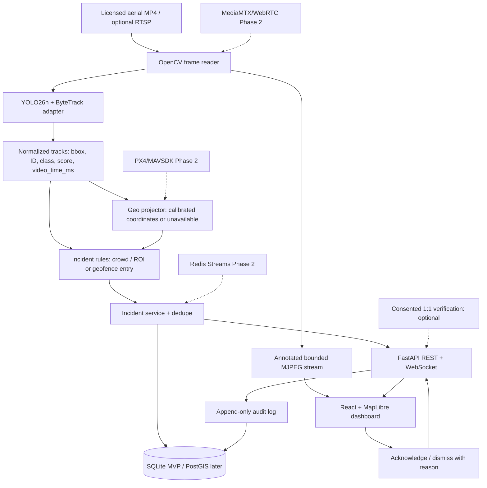

# Astra Fly — CipherCop 2026 Track 1 Engineering Blueprint

**Derived from:** Team Astra Fly's *CipherCop 2026 Track 1 — Technology Selection and Implementation Research* supplied in the conversation, November 20, 2026.

**Scope:** A functioning drone-video-to-geospatial-public-safety incident workflow. The official theme names drone technology, facial recognition, live law-and-order surveillance and geospatial mapping, but does **not** mandate our chosen implementation details. All implementation choices below are independent recommendations. The user's research states a submission deadline of **November 20, 2026, 11:59 PM IST**, and finals November 30–December 1.

## 1. Product definition and demo success criterion

**Working title:** Astra Fly Public Safety Command Center.

The minimum credible demo must let an operator select a properly licensed, prerecorded drone/aerial video; start video processing; see actual person/vehicle detections and transient anonymous track IDs; trigger two explainable alert types (*crowd count above threshold*, *restricted-zone entry*); see geospatial context where the source is calibrated; review an evidence frame/clip; acknowledge or dismiss the alert; and see an append-only audit entry. No covert identification, automated policing action, or unapproved live drone flight is part of the MVP.

**One-line pitch:** “Astra Fly turns drone imagery into geolocated, explainable, human-reviewed public-safety alerts in near real time.” Only use “near real time” when measured on demo hardware, not when playing precomputed results.

## 2. What to build—and what to postpone

### Core: submission-critical
1. One replay MP4 with verified usage rights and source attribution; an optional prerecorded, team-owned scenario.
2. Real OpenCV frame reading and real pretrained person/vehicle inference. Default: Ultralytics YOLO26n with `model.track(..., persist=True, tracker='bytetrack.yaml')` behind a `VisionEngine` interface; use actual installed API signatures. The model and toolkit have **AGPL-3.0 obligations** under Ultralytics licensing; document the exact dependencies, model origin and terms. The research recommends RT-DETRv2/Apache-2.0 as an alternate future path, not a last-minute second detector build.
3. Anonymous per-run track IDs. No name lookup or tracking people across sources.
4. One rules engine with *crowd threshold* and *zone intrusion*, consecutive-frame confirmation, deduplication and cooldown; emit `candidate_incident`, not “confirmed crime.”
5. Optional pixel-to-world homography **for a fixed/hovering camera with ground-plane calibration**; explicitly mark camera location versus detected target location. Uncalibrated sources have `location = null` and `geo_status = 'unavailable'`. Map an image-space ROI if no georeference is possible and LABEL it image-space, not a real-world geofence.
6. FastAPI, SQLite via SQLAlchemy + Alembic, Pydantic models, REST + WebSocket events, server-side MJPEG annotated stream for first demo. Run the inference worker as one controlled background thread/task in a single Uvicorn worker (no duplicated reload child process). Do not block the event loop or launch separate model instances per HTTP request.
7. React/Vite/TypeScript dashboard + MapLibre, incident list, source provenance, map markers only for calibrated locations, demo start/stop, operator review and history.
8. README, dependency/license inventory, deterministic synthetic test fixtures, evaluation scripts, and a recorded fallback demo.

### Phase 2: if the vertical slice works
- Replace MJPEG with **MediaMTX RTSP→WebRTC/HLS**, and add actual RTSP source support. MediaMTX is a separate media router and should not be copied into the repo.
- Replace SQLite with PostgreSQL + PostGIS via a storage adapter and migrations. Spatial points use `SRID 4326`; always serialize GeoJSON in longitude, latitude order.
- Add Redis Streams for durable service-to-service event delivery; persistence-first API remains the source of truth. Consumers use idempotency keys and acknowledgments.
- Add PX4/Gazebo + MAVSDK only with supported hardware or ample setup time. Drone latitude/longitude **does not equal** the latitude/longitude of a person in the frame.
- Add evidence clips, configurable retention, auth and role-based access, image calibration UI, health/latency dashboards.

### Deliberately out of MVP
- Citywide deployment, multiple uncontrolled live streams, unverified violence classifier, cross-camera identity association, mass face identification, automated enforcement, weapon targeting, live flight in restricted airspace, Kafka, GPU optimization before correctness, model training before end-to-end operation.

## 3. Technology decisions

| Area | Start now | Future / caveat |
|---|---|---|
| Runtime | Python 3.11, FastAPI, OpenCV | Separate inference service later |
| Object detection | YOLO26n/ByteTrack via Ultralytics | Verify model retrieval and AGPL; RT-DETRv2 Apache-2.0 adapter later |
| Image transport | MJPEG from bounded in-memory latest-frame store | MediaMTX + WebRTC for lower latency and efficiency |
| Event processing | Pure Python rule engine, SQLite persistence | Redis Streams only when services are split |
| GIS | MapLibre + GeoJSON and calibrated homography | PostgreSQL/PostGIS, GNSS/gimbal projection with error bounds |
| Frontend | React/Vite/TypeScript | No extra frontend framework required |
| Deployment | Python venv + npm; optional Docker Compose | GPU images need compatible drivers, no hard-coded CUDA version |
| Face functionality | Disabled-by-default UI boundary / consented reference-image 1:1 verification only if built | Never enable 1:N watchlist or claim drone faces are identifiable |

**Useful codebase architecture references:**
- Ultralytics: https://gitdiagram.com/ultralytics/ultralytics — `ultralytics/engine`, `ultralytics/trackers/byte_tracker.py`
- ByteTrack: https://gitdiagram.com/foundationvision/bytetrack — tracking association and ID lifecycle
- FastAPI: https://gitdiagram.com/fastapi/fastapi — routing, dependency injection, security, WebSockets
- MediaMTX: https://gitdiagram.com/bluenviron/mediamtx — media ingest/read routing and access control
- RT-DETR: https://gitdiagram.com/lyuwenyu/rt-detr — alternate detection models and deployment

GitDiagram diagrams describe *those public repositories*, not the new Astra Fly repository. Once Astra Fly's code is hosted in a public GitHub repo, its own architecture may be available from `https://gitdiagram.com/<owner>/<repo>`; do not fabricate an existing diagram for private or nonexistent code.

## 4. Proposed end-to-end architecture



**Thread and event-flow policy:** a single `VideoWorker` owns `VideoCapture`, model and tracker. It pushes a *bounded* latest JPEG frame to a thread-safe store and normalized observations to `IncidentService`. `IncidentService` commits incidents/audit records, then notifies a broker of connected WebSocket clients; a reconnecting browser calls `GET /incidents` to recover state. Only one processing run can own a given source at once. The worker yields, stops, or emits explicit errors on unavailable video/model. MJPEG is an interim demo transport, not a production video architecture.

## 5. Suggested repo structure

```text
astra-fly/
├── AGENTS.md                      # Project invariants for Codex
├── README.md
├── .env.example
├── .gitignore
├── compose.yaml                  # Optional on day one, phase 2 services via profiles
├── backend/
│   ├── pyproject.toml
│   ├── alembic.ini
│   ├── migrations/
│   ├── app/
│   │   ├── main.py
│   │   ├── config.py
│   │   ├── api/{health,runs,incidents,geofences,stream,websocket}.py
│   │   ├── contracts/{events,tracks,geo}.py
│   │   ├── db/{base,session,models}.py
│   │   ├── services/{incident_service,review_service,audit_service}.py
│   │   ├── vision/{source,engine,ultralytics_adapter,video_worker,frame_store}.py
│   │   ├── analytics/{rules,rule_state}.py
│   │   └── geo/{calibration,projection,geofences}.py
│   └── tests/{test_api,test_rules,test_geo,test_review,test_worker}.py
├── frontend/
│   ├── package.json
│   ├── src/{api,types,components,map,views,hooks}/
│   └── public/
├── data/
│   ├── README.md                 # Source/license/provenance, no unlicensed uploads
│   ├── demo_video/.gitkeep
│   ├── calibration/
│   └── fixtures/
├── scripts/{smoke_test,benchmark,export_demo}.py
└── docs/{architecture,api,privacy,testing,demo-script,submission-checklist}.md
```

## 6. Contracts that must be frozen before parallel coding

### Typed frame / track observations

```json
{
  "schema_version": "1.0",
  "run_id": "run_demo_001",
  "source_id": "drone_replay_01",
  "frame_index": 120,
  "video_time_ms": 4000,
  "captured_at": null,
  "mode": "replay",
  "geo_status": "calibrated",
  "tracks": [
    {
      "track_id": "run_demo_001:7",
      "object_class": "person",
      "detector_confidence": 0.82,
      "bbox_xyxy": [122.0, 220.0, 165.0, 332.0],
      "bottom_center_px": [143.5, 332.0],
      "location": {"type": "Point", "coordinates": [78.4421, 17.4126]},
      "horizontal_error_m": null
    }
  ]
}
```

The coordinates above are **illustrative schema values**, not verified locations from any video. `captured_at` is null for videos lacking timestamp metadata; `video_time_ms` is video-relative; replay processing time is separately recorded. `horizontal_error_m` is null until an uncertainty estimate has actually been evaluated, rather than inventing a numerical radius.

### Incident contract

```json
{
  "id": "inc_000042",
  "run_id": "run_demo_001",
  "source_id": "drone_replay_01",
  "event_type": "zone_intrusion",
  "severity": "review",
  "rule_name": "restricted_zone_entry",
  "rule_details": {"consecutive_frames": 4, "zone_id": "area_1", "track_id": "run_demo_001:7"},
  "video_time_ms": 4000,
  "observed_at": null,
  "created_at": "2026-11-20T13:05:00Z",
  "location": null,
  "geo_status": "image_roi_only",
  "evidence_url": "/api/v1/incidents/inc_000042/thumbnail",
  "review_status": "pending",
  "reviewer": null,
  "reviewed_at": null
}
```

**Important:** `severity='review'` indicates an operator-review candidate, not an objectively verified security threat; a rules engine must not generate a fake, calibrated event confidence. Store causal rule measurements instead.

### Minimal endpoints

```text
GET  /api/v1/health
GET  /api/v1/sources
POST /api/v1/runs/start             {source_id, mode:'replay'}
POST /api/v1/runs/stop              {run_id}
GET  /api/v1/runs/status
GET  /api/v1/stream/annotated.mjpg
GET  /api/v1/incidents?review_status=pending
GET  /api/v1/incidents/{id}
POST /api/v1/incidents/{id}/review  {decision:'acknowledged'|'dismissed', reason:'...'}
GET  /api/v1/incidents/{id}/audit
GET  /api/v1/geofences
POST /api/v1/geofences
WS   /ws/events
```

Protect mutating routes with at least a local operator token for MVP, maintain a reviewer identity, configure CORS for local UI origin, validate uploaded paths against allowlisted directories, and do not expose raw filesystem paths in the public API. `POST /api/v1/observations` may be added for deterministic testing / external producers, but **not** as an unauthenticated public event-forging endpoint.

### Storage

`source(id, title, video_path, video_sha256, rights_note, geo_mode)`, `run(id, source_id, mode, status, started_at, stopped_at)`, `incident(id, run_id, source_id, event_type, rule_details_json, video_time_ms, location_json_nullable, geo_status, review_status, evidence_path, created_at)`, `audit(id, incident_id, actor, action, reason, created_at)`, `geofence(id, label, geometry_geojson, space_type, enabled)`, `calibration(id, source_id, pixel_points, geo_points, method, reprojection_error, valid_for_frame_range)`. Every incident must have run and source provenance. Track observations need not be retained by default.

## 7. Rule definitions and geospatial correctness

**Crowd threshold:** count simultaneously active, confidently detected *person tracks* within a defined scene or region. Use temporal smoothing, 3–5 consecutive qualifying frames, one incident per threshold crossing, and cooldown. Do not describe this as “people per square metre” without validated map scale and perspective correction.

**Restricted-zone entry:** for a calibrated fixed camera, project each track's footpoint using verified homography to ground-plane coordinates and test against a GeoJSON polygon. If calibration is missing, use an explicitly labeled image-coordinate ROI and set `geo_status='image_roi_only'`; do not place a fabricated incident marker on a geographic map. Implement entrance transitions and cooldown so every video frame does not create a duplicate incident.

**Homography limitations:** require at least 4 correct, noncollinear pixel↔map control-point correspondences, consistent video resolution, source camera stable relative to the scene, and a near-planar ground assumption. Report reprojection residuals; reject invalid/ill-conditioned transforms. A moving/gimballed drone needs time-varying pose, camera intrinsics and ground intersection—not a single static transform. GPS of the drone cannot be copied onto each detected person.

**Identity safeguards:** no automatic identity claims from public drone footage. Any optional manual 1:1 verification must require explicit volunteer consent, opt-in enrollment, face-image quality checks, human confirmation, deletion and license review; no broad 1:N watchlist or scraped face dataset.

## 8. Execution roadmap (one or two contributors + Codex)

| Gate | User-owned implementation window | Engineer A (vision/backend) | Engineer B (frontend/integration) | Definition of done |
|---|---|---|---|---|
| 0 | 0–1h | Write contracts, fixture paths, smoke test | UI wireframe and UX states | repo boots; model mode explicit |
| 1 | 1–3h | FastAPI + SQLite + rule tests | React shell + typed API client | synthetic incident creates API record and WS update |
| 2 | 3–6h | MP4 + actual YOLO/ByteTrack + worker | Live annotated MJPEG panel | real detections; IDs; run start/stop; model error clear |
| 3 | 6–8h | calibration / ROI / rule dedupe | MapLibre + alert review / audit UI | real alert from input arrives on dashboard and can be reviewed |
| 4 | 8–10h | benchmark, retries, evidence image | end-to-end polish and fallback | clean install; smoke test; screenshot/video recorded |
| 5 | after MVP / finals | RTSP + MediaMTX, PostGIS, Redis, telemetry | geofence editor, richer controls, metrics | only claim modules that actually work |

**On November 20, prioritize gates 0–4, README, licensed dataset links, and PPT/PDF before the 11:59 PM IST submission deadline stated in the research.** Do not start Phase 2 before a repeatable end-to-end run exists. The time bands above are team-planning targets, not promises of completion.

### Parallelism protocol
- Engineer A owns `backend/app/vision`, `backend/app/analytics`, `backend/app/geo`, database migrations, Python tests.
- Engineer B owns `frontend`, documentation, API client, E2E testing, presentation assets.
- Freeze the JSON schemas and endpoint names before parallel prompts. Use branch-per-task or Git worktrees. No concurrent edits to the same migration, generated API type file or lockfile.
- After each Codex step: inspect git diff; run tests; record actual output; commit a small, reversible change.

## 9. Tests, quality gates and instrumentation

**Unit:** `pytest` for crowd threshold and hysteresis/cooldown, intrusion entry transition, missing geo and invalid homography, idempotency and event review transitions; no external network or GPU dependency. Add a synthetic detector fixture clearly marked *test only*.

**API:** FastAPI TestClient for health, start/stop conflict, persistent incidents, review/audit, malformed payloads, CORS and WS state recovery; `/openapi.json` generates clean schema.

**System smoke test:** run a real licensed 30–90-second MP4 on one laptop with model weights available; view annotated frames, event counter, review and audit; restart backend and confirm prior incident persists; test a new browser tab/reconnect.

**Performance:** record CPU/GPU, OS, model file/version, image size, decoding, inference, tracking, event processing, stream latency (if instrumented), FPS, end-to-end time-to-alert. Distinguish capture-to-detection from inference-only time. For recorded file processing, distinguish processing FPS from playback FPS. Report measured values or *not measured*, never fabricate metrics.

**Detection reliability:** use held-out annotated aerial samples where legal; report precision/recall/mAP only when ground truth is available. False alerts per demo clip, missed intended events, crowd-count error, ID switches and measured geo reprojection error are more defensible than unsupported “AI accuracy” claims.

**No-demo-fraud rule:** if the detector falls back to mock mode or precomputed overlays, show an obvious `SIMULATED / REPLAY` indicator and explain it; never label static results “live inference.”

## 10. Demo storyboard (under 3 minutes)

0:00–0:20: Introduce problem and show licensed-source provenance + “Replay mode” indicator.

0:20–0:55: Start video processing and show actual anonymous person/vehicle tracks; explain no routine identity recognition.

0:55–1:25: Crossing of restricted image ROI or calibrated geographic zone triggers a candidate incident; show what triggered it and temporal evidence.

1:25–1:55: Crowd count exceeds configurable threshold; show separate event, source/run/footage time.

1:55–2:25: Operator clicks incident; sees evidence, map if geolocation is valid or explicitly “location unavailable”; acknowledges/dismisses with reason.

2:25–3:00: Show persistent audit timeline, benchmark panel, clear next-stage MediaMTX/PostGIS/telemetry plan and privacy safeguards.

Fallback in case of a broken live demo: an honest, pre-recorded screen capture of the same measured run; locally persisted incidents; a README with reproducible steps and dataset links. Never pretend backup footage is fresh live surveillance.

## 11. Submission checklist

- [ ] Source repository contains working README (Windows PowerShell and Linux/WSL commands), `.env.example`, dependency lockfiles, `AGENTS.md` and tests.
- [ ] `scripts/smoke_test.py` or equivalent verifies `/health`, creation/review of a test incident, and clean service startup.
- [ ] One real reproducible video run, screenshot, or screen recording; note OS/hardware/model, measured results and limitations.
- [ ] Source video/dataset ownership, attribution, license links, permitted distribution; use download links instead of committing restricted third-party videos.
- [ ] PPT/PDF with problem statement, architecture, technology choice, working screenshots, results, privacy, roadmap and demo flow.
- [ ] No personal biometric embeddings in Git, no secrets in Git, no scraped face images, no unfounded deployment/legal claims.

## 12. Helpful official documentation

- YOLO26 / Ultralytics: https://docs.ultralytics.com/models/yolo26 and https://www.ultralytics.com/license
- RT-DETRv2: https://github.com/lyuwenyu/RT-DETR
- FastAPI WebSockets: https://fastapi.tiangolo.com/advanced/websockets/
- MediaMTX: https://mediamtx.org/docs/kickoff/introduction
- PostGIS: https://postgis.net/docs/en/using_postgis_query.html
- MapLibre: https://maplibre.org/maplibre-gl-js/docs/
- Redis Streams: https://redis.io/docs/latest/develop/use-cases/streaming/
- PX4 simulation: https://docs.px4.io/main/en/simulation/
- NIST face evaluation: https://pages.nist.gov/frvt/html/frvt_demographics.html
- India's drone rules: https://www.civilaviation.gov.in/ministry-documents/rules/drones-rules-2021-dated-25-august-2021

For the implemented MVP, start with the [project README](README.md) and [verification log](docs/STATUS.md).
