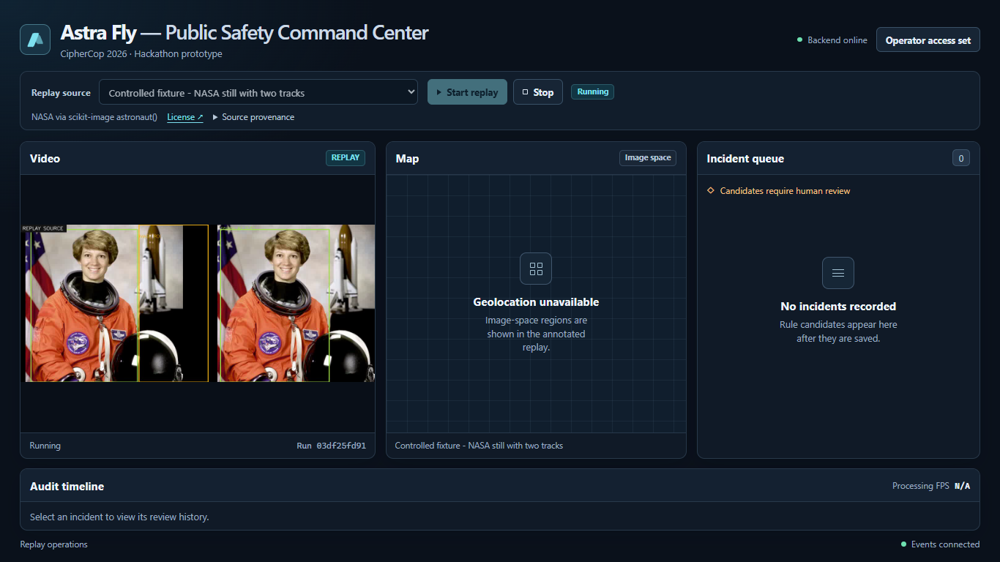
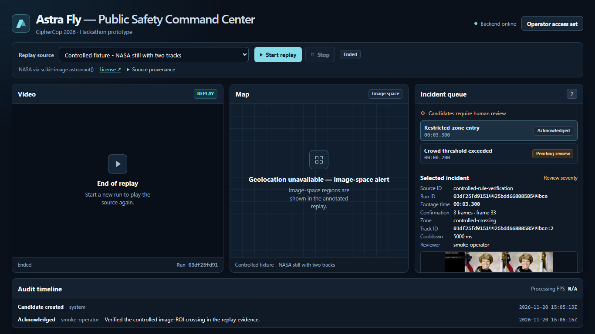

<h1 align="center">AstraSentinel</h1>

<p align="center"><strong>Public-safety replay with explainable alerts and human review</strong><br>
Team Astra Fly · CipherCop 2026 · Track 1</p>

<p align="center">
  
  
  
  
  
  
</p>

<p align="center">
  <a href="#one-click-start-on-windows">Start on Windows</a> ·
  <a href="#run-the-controlled-demo">Setup</a> ·
  <a href="#dashboard">Screenshots</a> ·
  <a href="docs/ARCHITECTURE.md">Architecture</a> ·
  <a href="docs/BENCHMARKS.md">Benchmarks</a>
</p>

## Dashboard



*Annotated replay from a controlled scenario. Two copies of a NASA still exercise real person detection and tracking.*



*After restart, the dashboard still shows the two candidates and the operator’s saved acknowledgement. The image-space zone has no map marker.*

Screenshots captured from the running app. Replay imagery is credited to NASA via scikit-image. [Source provenance](data/README.md#controlled-rule-verification-source)

## How it works

1. **Replay** permissioned MP4 footage through OpenCV, YOLO26n, and ByteTrack. Track IDs are anonymous and scoped to a single run.
2. **Inspect** crowd and zone-entry candidates with footage time, rule measurements, and an optional confirmation frame. Map markers require valid fixed-scene calibration.
3. **Review** each candidate with a reason. SQLite stores the decision and append-only audit so the dashboard can recover them after a restart.

## One-click start on Windows

Double-click [Start-AstraSentinel.bat](Start-AstraSentinel.bat) after the one-time install and source setup. It uses the root `.env`, starts the backend and dashboard on ports 8000 and 5173, and opens your browser when both are ready. Enter the private operator token under **Operator access**, then select a source and start replay. Press **Enter** in the launcher window to stop both servers.

For a fresh checkout, follow the setup below. After preparing the controlled demo, you can start that configuration with `.\Start-AstraSentinel.bat --env-file data/evidence/controlled-demo/.env` from PowerShell. Add `--check` to verify startup and immediately stop both servers without opening a browser.

## Run the controlled demo

This walkthrough uses a NASA still to build a labeled test clip of two person tracks. The detector and tracker run on the resulting MP4. The private aerial excerpt is optional for this walkthrough.

### Requirements

Install CPython 3.11, Node.js 24, npm, and [uv](https://docs.astral.sh/uv/getting-started/installation/). The demo runs on CPU. Initial dependency installation needs package-registry access or a populated local cache.

From a fresh checkout in PowerShell:

```powershell
git clone --branch main https://github.com/dsreecharan/AstraSentinel.git
Set-Location AstraSentinel
Set-Location backend
uv sync --locked --extra test --extra vision --python 3.11 --no-python-downloads
Set-Location ..
```

Download the [pinned NASA sample](https://github.com/scikit-image/scikit-image/blob/v0.25.2/skimage/data/astronaut.png) as `astronaut.png` to your temporary directory. Supply the trusted [YOLO26n detection checkpoint](https://github.com/ultralytics/assets/releases/tag/v8.4.0) at `data/weights/yolo26n.pt` under the applicable [Ultralytics terms](https://www.ultralytics.com/license).

| Input | Expected SHA-256 |
| --- | --- |
| `astronaut.png` | `88431cd9653ccd539741b555fb0a46b61558b301d4110412b5bc28b5e3ea6cb5` |
| `yolo26n.pt` | `9b09cc8bf347f0fc8a5f7657480587f25db09b34bf33b0652110fb03a8ad4fef` |

Verify the downloads with `Get-FileHash -Algorithm SHA256`. The demo opens the configured local checkpoint.

### Prepare the replay

From the repository root, prepare a new private stage.

```powershell
$Demo = Join-Path (Get-Location).Path "data/evidence/controlled-demo"
$Still = Join-Path $env:TEMP "astronaut.png"
.\backend\.venv\Scripts\python.exe scripts/smoke_test.py prepare --controlled-only --output $Demo --still $Still --weights data/weights/yolo26n.pt
if ($LASTEXITCODE -ne 0) { throw "Demo preparation failed" }
```

Preparation creates a separate SQLite database, a private operator token, and the configured image region. The incident queue starts empty. For another clean run, choose a new `$Demo` directory.

### Start the dashboard

From the repository root, install the dashboard dependencies once and start both servers using the prepared stage.

```powershell
npm.cmd --prefix frontend ci --no-audit --no-fund
if ($LASTEXITCODE -ne 0) { throw "Dashboard install failed" }
.\Start-AstraSentinel.bat --env-file (Join-Path $Demo ".env")
```

1. The launcher opens [the dashboard](http://localhost:5173). The [API health endpoint](http://127.0.0.1:8000/api/v1/health) runs on port 8000.
2. Under **Operator access**, enter `ASTRA_OPERATOR_TOKEN` from the stage’s private `.env`, without the surrounding quotes.
3. Select **Controlled fixture - NASA still with two tracks**, then **Start replay**. The run should show two review candidates, one for the crowd threshold and one for image-region entry. The image-space alert has unavailable geolocation.
4. Open the zone candidate, inspect the confirmation frame, and acknowledge or dismiss it with a reason. The audit timeline records that decision. Restart the API with the same stage to check persistence.

The [operator walkthrough](docs/DEMO_SCRIPT.md) provides the presentation sequence. The [system smoke test](docs/SMOKE_TEST.md) includes the licensed aerial excerpt and restart checks.

## Run the tests

From `backend/` on Windows:

```powershell
uv sync --locked --extra test --python 3.11 --no-python-downloads
.\.venv\Scripts\python.exe -m pytest -q -rs
```

From `frontend/` after `npm.cmd ci --no-audit --no-fund`:

```powershell
npm.cmd run lint
npm.cmd run typecheck
npm.cmd test
npm.cmd run build
```

The basic tests use synthetic fixtures. The optional real-inference test requires the vision extra, approved MP4 footage, and a local checkpoint. See [configuration](docs/CONFIGURATION.md) for the exact command.

## Linux or WSL

Install the same Python and Node versions in Linux, then run `uv sync --locked --extra test --extra vision --python 3.11 --no-python-downloads` from `backend/`. From the repository root, prepare and start a stage with the same verified downloads.

```bash
demo="$PWD/data/evidence/controlled-demo"
backend/.venv/bin/python scripts/smoke_test.py prepare --controlled-only --output "$demo" \
  --still "${TMPDIR:-/tmp}/astronaut.png" --weights data/weights/yolo26n.pt &&
  (cd backend && .venv/bin/python -m app.serve --env-file "$demo/.env")
```

From `frontend/` in a second terminal, run `npm ci --no-audit --no-fund` and `npm run dev`. The dashboard and API use the same loopback addresses. Use `.venv/bin/python -m pytest -q -rs` from `backend/` for the test suite. Full replay verification is recorded for Windows in the [verification log](docs/STATUS.md).

## Bring your own footage

Register an approved local MP4, record its provenance, and use the root `.env` for normal operation. [Source registration and rule configuration](docs/CONFIGURATION.md#register-one-licensed-mp4) · [Data and model provenance](data/README.md)

## Documentation

| Topic | Reference |
| --- | --- |
| System design and limitations | [Architecture](docs/ARCHITECTURE.md) |
| Configuration, calibration, and real-inference checks | [Configuration](docs/CONFIGURATION.md) |
| REST endpoints and WebSocket events | [API contracts](docs/CONTRACTS.md) |
| CPU measurements and what they cover | [Benchmarks](docs/BENCHMARKS.md) |
| Verified tests, results, and remaining gaps | [Verification log](docs/STATUS.md) |

AstraSentinel is a loopback hackathon MVP with human review. Detector accuracy, surveyed geolocation, and capture-to-alert latency remain unmeasured. Keep private footage, weights, credentials, runtime databases, and retained evidence out of version control. [Privacy and license inventory](data/README.md)

Experimental transport and storage work is available separately on [`phase2/optional-profiles`](https://github.com/dsreecharan/AstraSentinel/tree/phase2/optional-profiles).
